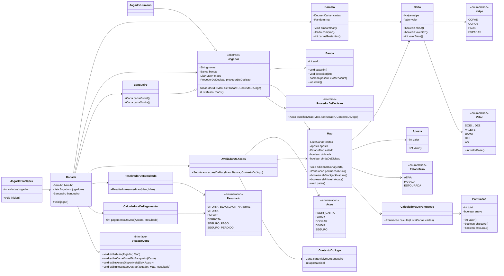
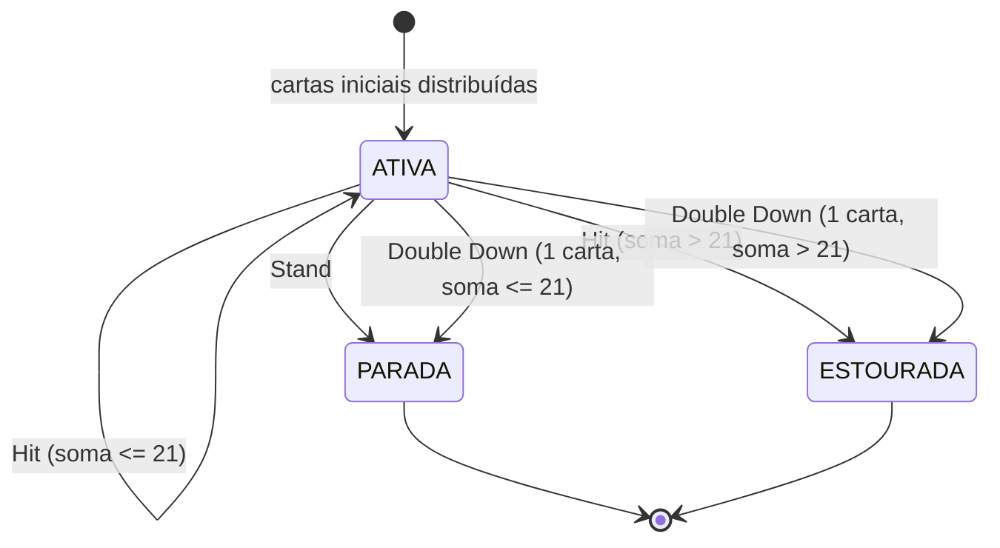

# Especificação do Projeto — Blackjack em Java

> Documento de especificação funcional, não funcional e de arquitetura (orientada a objetos / SOLID)
> para o jogo de Blackjack (Vinte e Um), a ser implementado em Java para o trabalho de Teste de
> Software. Serve como base para o desenho das classes, para a implementação e para a definição dos
> casos de teste.

## Sumário

1. [Introdução](#1-introdução)
2. [Requisitos Funcionais](#2-requisitos-funcionais)
3. [Requisitos Não Funcionais](#3-requisitos-não-funcionais)
4. [Premissas e Decisões de Design](#4-premissas-e-decisões-de-design)
5. [Modelo de Domínio](#5-modelo-de-domínio)
6. [Aplicação dos Princípios SOLID](#6-aplicação-dos-princípios-solid)
7. [Estrutura de Pacotes Proposta](#7-estrutura-de-pacotes-proposta)
8. [Fluxo de Execução de uma Rodada](#8-fluxo-de-execução-de-uma-rodada)
9. [Máquina de Estados da Mão](#9-máquina-de-estados-da-mão)
10. [Regras de Pagamento (Resumo)](#10-regras-de-pagamento-resumo)
11. [Critérios de Aceitação](#11-critérios-de-aceitação)
12. [Fora de Escopo](#12-fora-de-escopo)
13. [Glossário](#13-glossário)

---

## 1. Introdução

O sistema simula uma mesa de Blackjack jogada no terminal, entre **1 a 3 jogadores humanos** e
**1 dealer (banqueiro)** controlado por regras fixas (IA simples). Todos os jogadores compartilham o
mesmo baralho. O objetivo de cada jogador é obter uma pontuação de mão o mais próxima possível de 21,
sem ultrapassar esse valor, superando a mão do dealer.

A implementação deve ser feita em **Java**, aplicando **SOLID** e **Orientação a Objetos**, modelando
como classes as entidades do mundo real do jogo: carta, baralho, ficha/aposta, pontuação, jogador
(genérico) e dealer (um tipo de jogador com decisão automática).

---

## 2. Requisitos Funcionais

### 2.1 Configuração e Início de Jogo

| ID | Descrição |
|----|-----------|
| RF01 | O sistema deve solicitar a banca inicial do jogador (número inteiro positivo de fichas). |
| RF02 | O sistema deve solicitar o valor da aposta inicial da rodada `b` (inteiro positivo, `b ≤ banca`). |
| RF03 | O sistema deve suportar de 1 a 3 jogadores humanos simultâneos, cada um com sua própria banca e aposta, compartilhando um único baralho com o dealer. |
| RF04 | No início de cada rodada, devem ser distribuídas 2 cartas para cada jogador e 2 cartas para o dealer (uma visível, uma oculta). |

### 2.2 Ações do Jogador

| ID | Ação | Regra |
|----|------|-------|
| RF05 | **Hit** | Jogador recebe mais uma carta somada à mão atual. Disponível sempre que a mão estiver ativa e com pontuação < 21. |
| RF06 | **Stand** | Encerra a jogada da mão, mantendo a pontuação atual. Disponível sempre que a mão estiver ativa. |
| RF07 | **Double Down** | Dobra a aposta da mão atual (exige saldo em banca ≥ aposta atual da mão), recebe obrigatoriamente **uma única carta adicional** e a mão é encerrada automaticamente. Disponível **somente** como primeira ação da mão. |
| RF08 | **Split** | Disponível apenas quando a mão possui exatamente 2 cartas de mesmo valor numérico (ou duas figuras) e é a primeira ação. Exige aposta adicional igual à aposta inicial da mão (saldo em banca ≥ aposta). Divide a mão em duas mãos independentes, cada uma recebendo imediatamente uma nova segunda carta. Cada mão resultante é jogada de forma totalmente independente (incluindo possibilidade de novo split, hit, stand, double, conforme regras). |
| RF09 | **Insurance** | Disponível **apenas no início da rodada**, antes de qualquer outra ação, e **apenas** se a carta visível do dealer for um Ás. Aposta de seguro de até metade da aposta inicial (exige saldo em banca ≥ b/2). |

### 2.3 Regras do Dealer

| ID | Descrição |
|----|-----------|
| RF10 | Se a pontuação da mão do dealer for < 17, ele é obrigado a pedir carta (Hit). |
| RF11 | Se a pontuação da mão do dealer for ≥ 17, ele é obrigado a parar (Stand). |
| RF12 | O dealer não aposta, não faz split, double down nem insurance — apenas segue a regra fixa acima. |

### 2.4 Baralho e Pontuação

| ID | Descrição |
|----|-----------|
| RF13 | O baralho utilizado é o convencional de 52 cartas (4 naipes × 13 valores). |
| RF14 | Cartas numéricas (2 a 10) valem o seu valor nominal. |
| RF15 | Figuras (J, Q, K) valem 10 pontos. |
| RF16 | Ás vale 11 pontos; caso a soma total da mão ultrapasse 21 considerando o Ás como 11, ele é recalculado automaticamente como 1 ponto (soft → hard). |

### 2.5 Blackjack Natural

| ID | Descrição |
|----|-----------|
| RF17 | Blackjack Natural é a mão formada exatamente pelas duas primeiras cartas, sendo um Ás + uma carta de valor 10 (10, J, Q ou K), somando 21. |
| RF18 | Blackjack Natural tem prioridade sobre qualquer outra mão de 21 pontos formada com 3 ou mais cartas, inclusive a do dealer. |

### 2.6 Resultados e Pagamentos

| ID | Descrição |
|----|-----------|
| RF19 | Vitória comum (pontuação do jogador > dealer, sem estourar — inclui o caso de o dealer estourar) paga 1:1 sobre o valor apostado na mão. |
| RF20 | Vitória por Blackjack Natural paga o adicional de 3:2 sobre a aposta inicial (ao invés do 1:1 comum). |
| RF21 | Aposta de Seguro paga 2:1 sobre o valor investido no seguro caso o dealer confirme Blackjack Natural; caso contrário, o valor do seguro é perdido. |
| RF22 | Empate (Push): pontuações iguais entre jogador e dealer, ou ambos com Blackjack Natural — devolve a aposta principal ao jogador, sem ganho nem perda. |
| RF23 | Derrota: mão do jogador estourou (> 21) ou pontuação final inferior à do dealer sem este ter estourado — jogador perde o valor apostado naquela mão. |

### 2.7 Exibição em Tela (a cada rodada)

| ID | Descrição |
|----|-----------|
| RF24 | Exibir as cartas e a pontuação atual de cada mão de cada jogador. |
| RF25 | Exibir a carta visível do dealer (a carta oculta não é revelada até o fim da rodada). |
| RF26 | Exibir dinamicamente, para a mão em jogo, apenas as opções válidas no momento (Hit/Stand sempre que ativa e < 21; Double Down somente na 1ª ação com saldo suficiente; Split somente na mão inicial com cartas de mesmo valor e saldo suficiente; Insurance somente no início da rodada, se a carta visível do dealer for Ás e houver saldo suficiente). |
| RF27 | Ao final das jogadas de todos os jogadores e do dealer, exibir o resultado de cada mão (Vitória, Derrota, Blackjack Natural, Seguro Pago/Perdido ou Empate) e a banca atualizada de cada jogador. |
| RF28 | Oferecer, ao final de cada rodada, a opção de iniciar nova rodada ou encerrar o jogo. |

### 2.8 Término de Jogo

| ID | Descrição |
|----|-----------|
| RF29 | O jogo encerra quando o jogador optar por sair, ou quando a banca ficar insuficiente para cobrir a aposta mínima. |
| RF30 | Ao encerrar, o sistema deve exibir o saldo final da banca e o total de rodadas jogadas. |

---

## 3. Requisitos Não Funcionais

| ID | Descrição |
|----|-----------|
| RNF01 | Implementação em Java, executável via terminal (texto puro, sem GUI). |
| RNF02 | O código deve seguir os princípios **SOLID** (ver seção 6). |
| RNF03 | Deve-se aplicar Orientação a Objetos para representar as entidades do mundo real do domínio (carta, baralho, ficha/aposta, pontuação, jogador, dealer). |
| RNF04 | Funções e métodos devem ser pequenos e com responsabilidade única (evitar métodos "god-method"). |
| RNF05 | A lógica de domínio (regras do jogo) deve ser desacoplada da camada de entrada/saída (console), permitindo testar regras de negócio sem depender de `System.in`/`System.out`. |
| RNF06 | Fontes de aleatoriedade (embaralhamento) devem ser injetáveis, permitindo testes determinísticos. |
| RNF07 | O baralho é compartilhado entre todos os jogadores e o dealer na mesma rodada (uma única instância de baralho por rodada). |
| RNF08 | O sistema deve suportar no máximo 3 jogadores humanos + 1 dealer por mesa. |

---

## 4. Premissas e Decisões de Design

A especificação original descreve o fluxo principal no singular ("o jogador"), mas exige suporte
arquitetural a múltiplos jogadores. Para remover ambiguidades, assume-se:

1. **Multiplayer real, turnos sequenciais:** cada jogador humano tem banca e aposta inicial próprias.
   As cartas são distribuídas em rodadas (round-robin): uma carta para cada jogador, depois uma para o
   dealer, repetindo-se até completar 2 cartas por participante. Em seguida, cada jogador resolve
   **todas** as suas mãos (incluindo mãos originadas de split) antes de passar a vez ao próximo
   jogador; o dealer sempre joga por último.
2. **Insurance é por jogador, não por mão:** a decisão de seguro ocorre uma única vez por jogador por
   rodada, antes de qualquer Hit/Stand/Double/Split daquele jogador, e somente quando a carta visível
   do dealer é um Ás.
3. **`b` nas regras de saldo mínimo:** para Double Down e Split, `b` refere-se à aposta atual da mão
   sendo jogada (igual à aposta inicial da mão até que ela seja alterada por um double/split
   anterior). Para Insurance, `b` refere-se à aposta inicial da rodada daquele jogador.
4. **Split de figuras:** duas cartas são consideradas "mesmo valor" para fins de split se têm o mesmo
   valor numérico de pontuação (ex.: 10-10, 10-J, J-Q, Q-K são todas combinações válidas de 10 pontos).
5. **Blackjack Natural só é possível na mão original de 2 cartas:** mãos resultantes de split nunca são
   tratadas como Blackjack Natural mesmo que somem 21 com Ás + carta de 10, pois a regra define Natural
   como exclusivo das duas primeiras cartas distribuídas na rodada (consistente com RF17).
6. **Baralho único e renovado por rodada:** um novo baralho de 52 cartas é criado e embaralhado a cada
   rodada (a especificação não define uso de múltiplos baralhos/sapatilha nem carta de corte).
7. **Double Down after Split:** permitido independentemente por mão, respeitando RF07 (ser a primeira
   ação daquela mão específica).
8. **Banca mínima para iniciar/continuar:** a aposta mínima de referência para o critério de término de
   jogo (RF29) é a aposta inicial configurada para aquele jogador.

---

## 5. Modelo de Domínio

### 5.1 Visão Geral das Classes

| Classe / Interface | Tipo | Responsabilidade principal |
|---|---|---|
| `Naipe` | enum | Naipe da carta (Copas, Ouros, Paus, Espadas). |
| `Valor` | enum | Valor de face da carta (2–10, J, Q, K, A) e seu valor base em pontos. |
| `Carta` | classe (imutável) | Representa uma carta concreta (naipe + valor); sabe informar se é Ás / se vale 10. |
| `Baralho` | classe | Conjunto de 52 cartas; embaralha e distribui (`comprar`) cartas; compartilhado entre jogadores. |
| `CalculadoraDePontuacao` | serviço (stateless) | Calcula a pontuação de uma lista de cartas, aplicando o ajuste soft/hard do Ás. |
| `Pontuacao` | value object | Resultado do cálculo: valor total, se é "soft" (com Ás valendo 11) e se estourou. |
| `EstadoMao` | enum | Estado da mão: `ATIVA`, `PARADA`, `ESTOURADA`. |
| `Mao` | classe | Mão genérica de cartas associada a uma aposta; conhece suas cartas, status, se veio de split, se foi dobrada, e delega o cálculo de pontos ao `CalculadoraDePontuacao`. Classe comum usada tanto pelo jogador humano quanto pelo dealer. |
| `Aposta` | value object | Valor apostado (aposta principal de uma mão, aposta de seguro). |
| `Banca` | classe | Banca de fichas de um jogador: débito, crédito, checagem de saldo suficiente. |
| `Acao` | enum | Ações possíveis: `PEDIR_CARTA`, `PARAR`, `DOBRAR`, `DIVIDIR`, `SEGURO`. |
| `AvaliadorDeAcoes` | serviço (stateless) | Calcula, para uma mão/jogador/contexto, o conjunto de ações válidas no momento (regra dinâmica de disponibilidade). |
| `ContextoDoJogo` | value object | Informações da rodada necessárias para decisões: carta visível do dealer, aposta inicial, se é a primeira ação da mão etc. |
| `ProvedorDeDecisao` | interface | Abstrai *como* uma decisão de ação é obtida (humano via console, dealer via regra fixa). |
| `ProvedorDeDecisaoConsole` | classe | Implementação que pergunta ao jogador humano via terminal. |
| `ProvedorDeDecisaoDoBanqueiro` | classe | Implementação que aplica a regra fixa do dealer (hit < 17 / stand ≥ 17). |
| `Jogador` | classe abstrata | Jogador genérico: nome, `Banca`, lista de `Mao` (suporta múltiplas mãos por split), aposta de seguro opcional, e delega decisões ao seu `ProvedorDeDecisao`. |
| `JogadorHumano` | classe | Especialização de `Jogador` cujas decisões vêm de um `ProvedorDeDecisaoConsole`. |
| `Banqueiro` | classe | Especialização de `Jogador` com `ProvedorDeDecisaoDoBanqueiro`; expõe a carta visível e a oculta, não aposta. |
| `Resultado` | enum | Resultado possível de uma mão: `VITORIA_BLACKJACK_NATURAL`, `VITORIA`, `EMPATE`, `DERROTA`, `SEGURO_PAGO`, `SEGURO_PERDIDO`. |
| `ResolvedorDeResultado` | serviço (stateless) | Compara a mão do jogador com a do dealer e determina o `Resultado`. |
| `CalculadoraDePagamento` | serviço (stateless) | Calcula o valor a creditar/debitar na `Banca` do jogador a partir do `Resultado` e da `Aposta`. |
| `VisaoDoJogo` | interface | Abstrai a exibição de informações (cartas, pontuação, opções, resultados) — permite trocar a saída (console, testes) sem alterar a lógica. |
| `VisaoConsole` | classe | Implementação de `VisaoDoJogo` que imprime no terminal. |
| `PortaDeEntrada` | interface | Abstrai a leitura de dados do usuário (configuração inicial, escolha de ação, continuar/sair). |
| `EntradaConsole` | classe | Implementação de `PortaDeEntrada` via `Scanner`/console. |
| `Rodada` | classe | Orquestra uma rodada completa: distribuição inicial, coleta de seguros, turnos dos jogadores, turno do dealer e liquidação das apostas. |
| `JogoDeBlackjack` | classe | Controla o laço do jogo: contagem de rodadas, repetição enquanto houver banca suficiente e o jogador quiser continuar, resumo final. |

### 5.2 Diagrama de Classes



> Observação: os nomes de classes/métodos no diagrama seguem a convenção de código Java
> (PascalCase/camelCase), já traduzidos para português, conforme a implementação atual.

### 5.3 Por que `Mao` é uma classe independente (generalização Jogador ↔ Mão)

Conforme solicitado, o tipo `Mao` é desenhado como uma entidade própria, independente de `Jogador`,
contendo cartas, aposta e estado. Isso permite:

- Um `Jogador` manter uma **lista** de `Mao` (`List<Mao>`), suportando múltiplas mãos simultâneas após
  um Split, sem alterar a estrutura do jogador.
- O `Banqueiro` reutilizar exatamente a mesma classe `Mao` (sempre com uma única mão, sem aposta),
  evitando duplicação de lógica de pontuação/estado entre jogador e dealer.
- Toda a lógica de pontuação, estouro e estado viver dentro de `Mao`/`CalculadoraDePontuacao`, testável de
  forma isolada, sem depender de quem é o dono da mão.

---

## 6. Aplicação dos Princípios SOLID

| Princípio | Aplicação no projeto |
|---|---|
| **S** — Responsabilidade Única | Cada classe tem um único motivo para mudar: `Carta` só representa uma carta; `Baralho` só gerencia o monte de cartas; `CalculadoraDePontuacao` só calcula pontuação; `CalculadoraDePagamento` só calcula pagamentos; `VisaoDoJogo` só exibe informação; `Banca` só controla saldo. |
| **O** — Aberto/Fechado | Novas regras de decisão (ex.: dealer variante "hit em soft 17") podem ser adicionadas criando uma nova `ProvedorDeDecisao`/estratégia, sem alterar `Jogador`. Novos resultados de pagamento podem ser incluídos no `CalculadoraDePagamento` sem alterar `Mao` ou `Rodada`. |
| **L** — Substituição de Liskov | `Banqueiro` e `JogadorHumano` podem ser usados em qualquer lugar que espera um `Jogador` (ex.: dentro de `Rodada`), pois ambos respeitam o mesmo contrato (`decidir`, `maos()`), sem exigir checagens de tipo (`instanceof`) no código cliente. |
| **I** — Segregação de Interfaces | `ProvedorDeDecisao` expõe apenas o método de decisão de ação; `VisaoDoJogo` expõe apenas métodos de exibição; `PortaDeEntrada` expõe apenas leitura de dados. O `Banqueiro` não é forçado a depender de métodos de leitura de console, pois utiliza sua própria implementação fixa de decisão. |
| **D** — Inversão de Dependência | `Rodada`/`Jogador` dependem das abstrações `ProvedorDeDecisao`, `VisaoDoJogo` e `PortaDeEntrada`, não de implementações concretas de console. Isso permite substituir a interface por uma versão de testes (mocks/stubs) sem alterar a lógica de jogo, e injetar a fonte de aleatoriedade (`Random`) do `Baralho` para testes determinísticos. |

---

## 7. Estrutura de Pacotes Proposta

```
com.blackjack
├── domain
│   ├── card      → Naipe, Valor, Carta
│   ├── deck      → Baralho
│   ├── hand      → Mao, EstadoMao, Pontuacao, CalculadoraDePontuacao
│   ├── bet       → Aposta, Banca
│   ├── action    → Acao, AvaliadorDeAcoes, ContextoDoJogo
│   └── player    → Jogador, JogadorHumano, Banqueiro, ProvedorDeDecisao,
│                   ProvedorDeDecisaoConsole, ProvedorDeDecisaoDoBanqueiro
├── result
│   ├── Resultado
│   ├── ResolvedorDeResultado
│   └── CalculadoraDePagamento
├── round
│   ├── Rodada
│   └── JogoDeBlackjack
├── ui
│   ├── VisaoDoJogo, VisaoConsole
│   └── PortaDeEntrada, EntradaConsole
└── app
    └── main
```

---

## 8. Fluxo de Execução de uma Rodada

1. `JogoDeBlackjack` verifica se todos os jogadores possuem banca suficiente para a aposta mínima; caso
   contrário, encerra o jogo (RF29/RF30).
2. Cada jogador informa/confirma a aposta inicial da rodada (`b`).
3. `Rodada` cria/embaralha um novo `Baralho` e distribui 2 cartas para cada jogador e 2 para o dealer
   (1 visível, 1 oculta) — RF04.
4. Se a carta visível do dealer for um Ás, cada jogador (com saldo ≥ b/2) recebe a opção de Insurance
   — RF09.
5. Para cada jogador, para cada mão ativa (inclusive novas mãos geradas por Split):
   a. `VisaoDoJogo` exibe cartas, pontuação da mão, carta visível do dealer e as ações disponíveis
      (`AvaliadorDeAcoes`) — RF24–RF26.
   b. O jogador escolhe uma ação válida (Hit, Stand, Double Down ou Split).
   c. A mão é atualizada; o processo repete até a mão ficar `PARADA` ou `ESTOURADA`.
6. Após todos os jogadores finalizarem todas as suas mãos, o dealer revela a carta oculta e joga
   automaticamente conforme RF10/RF11.
7. Para cada mão de cada jogador, `ResolvedorDeResultado` determina o `Resultado` e `CalculadoraDePagamento` aplica o
   crédito/débito correspondente na `Banca` do jogador — RF19–RF23.
8. `VisaoDoJogo` exibe o resultado de cada mão e a banca atualizada — RF27.
9. O jogo pergunta se o jogador deseja uma nova rodada ou encerrar — RF28. Se sim, e houver banca
   suficiente, volta ao passo 2; caso contrário, encerra.
10. Ao encerrar, `JogoDeBlackjack` exibe o saldo final de cada jogador e o total de rodadas jogadas —
    RF30.

---

## 9. Máquina de Estados da Mão



O flag booleano `dobrada` em `Mao` registra se a mão foi encerrada por Double Down (afetando o valor
da aposta para fins de pagamento), e `vindaDeDivisao` indica se a mão se originou de um Split (afetando a
elegibilidade a Blackjack Natural, conforme premissa 5).

---

## 10. Regras de Pagamento (Resumo)

| Resultado | Condição | Pagamento sobre a aposta da mão |
|---|---|---|
| Blackjack Natural | Duas primeiras cartas = Ás + carta de valor 10; dealer não possui Blackjack Natural também | Devolve a aposta + 3:2 |
| Vitória comum | Pontuação do jogador > pontuação do dealer sem estourar (inclui dealer ter estourado) | Devolve a aposta + 1:1 |
| Empate (Push) | Pontuações iguais, ou ambos com Blackjack Natural | Devolve a aposta (sem ganho/perda) |
| Derrota | Jogador estourou, ou pontuação do jogador < dealer (sem dealer estourar) | Perde a aposta |
| Seguro pago | Dealer confirma Blackjack Natural | Devolve o seguro + 2:1 |
| Seguro perdido | Dealer não forma Blackjack Natural | Perde o valor do seguro |

---

## 11. Critérios de Aceitação

Cenários no estilo *Given/When/Then*, usados como base para os testes automatizados:

1. **Ás ajustado automaticamente (soft → hard)**
   *Dado* que a mão tem Ás + 6 (soft 17) e o jogador pede Hit recebendo um 10,
   *então* a pontuação final deve ser recalculada para 17 (Ás = 1), sem estourar.

2. **Blackjack Natural paga 3:2**
   *Dado* que as duas primeiras cartas do jogador são Ás + Rei e o dealer não tem Blackjack Natural,
   *então* o jogador recebe sua aposta de volta mais 3:2 sobre o valor apostado.

3. **Prioridade do Natural sobre 21 em 3+ cartas**
   *Dado* que o jogador tem Blackjack Natural e o dealer soma 21 com 3 cartas,
   *então* o jogador vence (não há empate).

4. **Empate entre dois Blackjacks Naturais**
   *Dado* que jogador e dealer possuem Blackjack Natural,
   *então* o resultado é Push e a aposta principal é devolvida.

5. **Double Down só na primeira ação**
   *Dado* que o jogador já pediu Hit nesta mão,
   *então* a opção Double Down não deve mais estar disponível para essa mão.

6. **Double Down exige saldo suficiente**
   *Dado* que a banca do jogador é menor que a aposta atual da mão,
   *então* Double Down não deve ser oferecido como opção válida.

7. **Split apenas em cartas de mesmo valor**
   *Dado* que a mão inicial é 10 e Q (ambas valendo 10),
   *então* a opção Split deve estar disponível, criando duas mãos independentes, cada uma recebendo uma
   nova carta.

8. **Mão originada de Split não forma Blackjack Natural**
   *Dado* que uma mão de split resulta em Ás + carta de valor 10,
   *então* o resultado deve ser tratado como 21 pontos comum (pagamento 1:1), não como Blackjack
   Natural (3:2).

9. **Insurance somente quando a carta visível do dealer é Ás**
   *Dado* que a carta visível do dealer não é um Ás,
   *então* a opção Insurance não deve ser oferecida.

10. **Insurance paga 2:1 quando dealer confirma Blackjack**
    *Dado* que o jogador apostou seguro e o dealer revela Blackjack Natural,
    *então* o jogador recebe 2:1 sobre o valor do seguro; a aposta principal segue as regras normais de
    resultado (push caso o jogador também tenha Natural, ou derrota da aposta principal caso contrário).

11. **Insurance perdido quando dealer não confirma Blackjack**
    *Dado* que o jogador apostou seguro e o dealer não tem Blackjack Natural,
    *então* o valor do seguro é perdido e a rodada segue normalmente para a aposta principal.

12. **Dealer obrigado a pedir carta abaixo de 17**
    *Dado* que a mão do dealer soma 16,
    *então* o dealer deve obrigatoriamente pedir mais uma carta.

13. **Dealer obrigado a parar a partir de 17**
    *Dado* que a mão do dealer soma 17 ou mais (incluindo 17 soft, conforme regra fixa definida),
    *então* o dealer deve parar e não pedir mais cartas.

14. **Vitória por estouro do dealer**
    *Dado* que o dealer estoura (> 21) e o jogador não estourou,
    *então* o jogador vence 1:1 independentemente da sua pontuação.

15. **Fim de jogo por banca insuficiente**
    *Dado* que a banca do jogador é menor que a aposta mínima configurada,
    *então* o jogo é encerrado automaticamente, exibindo saldo final e total de rodadas.

16. **Opções dinâmicas exibidas corretamente**
    *Dado* qualquer estado de mão/banca,
    *então* apenas as ações válidas naquele momento (conforme RF26) devem ser apresentadas ao jogador.

---

## 12. Fora de Escopo

- Interface gráfica (GUI) ou web; a interação é exclusivamente via terminal (texto).
- Uso de múltiplos baralhos (shoe) ou carta de corte (cut card); cada rodada usa um baralho novo de 52
  cartas.
- Persistência de dados entre execuções (histórico salvo em arquivo/banco de dados).
- Regras de variantes de casa não mencionadas na especificação original (ex.: rendição/surrender,
  "dealer hits soft 17" como regra alternativa configurável, re-split de Ases com limite diferenciado).
- Jogadores controlados por IA (além do dealer) ou modo multiplayer em rede.

---

## 13. Glossário

| Termo | Significado |
|---|---|
| Hit | Pedir mais uma carta. |
| Stand | Parar/manter a pontuação atual da mão. |
| Double Down | Dobrar a aposta, receber exatamente mais uma carta e encerrar a mão. |
| Split | Dividir duas cartas de mesmo valor em duas mãos independentes. |
| Insurance | Aposta adicional contra a chance de o dealer ter Blackjack Natural, disponível quando sua carta visível é um Ás. |
| Blackjack Natural | 21 pontos formados exatamente pelas duas primeiras cartas (Ás + carta de valor 10). |
| Bust / Estouro | Mão cuja pontuação ultrapassa 21 pontos (derrota automática). |
| Push | Empate entre jogador e dealer; aposta principal devolvida. |
| Soft hand | Mão em que o Ás está sendo contado como 11 pontos. |
| Hard hand | Mão em que o Ás está sendo contado como 1 ponto (ou mão sem Ás). |
| Banca | Saldo total de fichas disponível para um jogador apostar. |
